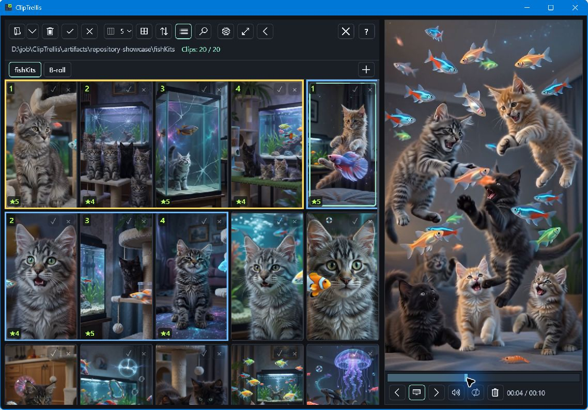

<h1> ClipTrellis</h1>

**Review and shortlist footage before you edit.** Open a folder of videos on Windows, preview takes alongside the thumbnail grid, and drag the clips you choose into your editor.

**Отбор видео перед монтажом в Windows.** Просматривайте исходники из папок, отмечайте удачные дубли и перетаскивайте их в редактор.

**[Download for Windows / Скачать для Windows](https://github.com/korzhy/VideoWall-Releases/releases/latest/download/VideoWall-Setup-x64-with-dotnet.exe)** · x64, .NET included / .NET включён

[Полная страница на русском](README.ru.md) · [User guide](docs/guide.md) · [What's new](https://github.com/korzhy/VideoWall-Releases/releases/latest)

*A shortlist from fishKits. Color borders separate groups, stars show ratings, and the numbers give a viewing order. The current clip is paused on the right, with B-roll open in a second tab.*

## Build a shortlist, then bring it into your edit

1. **Review the takes.** Press **Ctrl+O** to open a folder. Double-click a tile by default to open the preview alongside the grid. Press **Space** to play or pause and **PgUp / PgDn** to step through clips.
2. **Mark the clips you want.** In fishKits, you could give the aquarium shots one color and the close-ups another. Use **Alt+1–5** for color, **Ctrl+1–5** for rating and **N** to number your selection. Sort by rating or number to bring your shortlist to the front.
3. **Find a cutaway in another folder.** Press **Ctrl+T** to open B-roll in a separate tab. Switch back with **Ctrl+Tab** to pick up your search, selection and scroll position. The preview returns paused where you left it. Tabs last for the current session.
4. **Send the chosen file to your editor.** Drag a tile or the video in the preview into your editor's media area, for example in Clipchamp. After adding it, click **✓** on the tile to set it aside in **Used**. If you enable automatic filing in Settings, an accepted drop can do that for you. The next clip opens paused when ClipTrellis advances automatically.

## What happens to your files

| Action | Result |
| --- | --- |
| Drag a clip **out** of ClipTrellis | The receiving app gets the original file path. The original stays in its folder. |
| Drag a video **in** from Explorer | ClipTrellis copies it into the open folder. A colliding name gets a numbered suffix. When you add videos directly to the folder in Explorer, the grid and count update automatically. |
| Send a clip to **Used** or **Trash** | ClipTrellis hides it from the main grid. You can restore it from that section. |
| Choose **Move color group to a new folder** | ClipTrellis moves the group on disk and opens the new subfolder. Labels, ratings and numbers move with the clips. |

Permanent deletion is a separate, confirmed action inside **Trash** or **Used**. [File handling and recovery](docs/guide.md#file-handling)

## Install and get help

- **Windows 10 21H2 or later, or Windows 11, x64.** The download above includes the desktop runtime. The file name starts with `VideoWall-Setup` and installs ClipTrellis.
- **Already have .NET 10 Desktop Runtime x64?** Choose the [smaller installer](https://github.com/korzhy/VideoWall-Releases/releases/latest/download/VideoWall-Setup-x64-without-dotnet.exe). Use the same installer variant for manual updates, or use **Settings → Check for updates**.
- **Using ClipTrellis in Russian?** Choose **Русский** under **Settings → Interface language** and restart the app. [Русская инструкция](docs/guide.ru.md)
- Open the [user guide](docs/guide.md) for shortcuts, preview settings, supported extensions and playback help. If you run into a problem, [open an issue](https://github.com/korzhy/VideoWall-Releases/issues/new) with the app version and steps to reproduce it.
