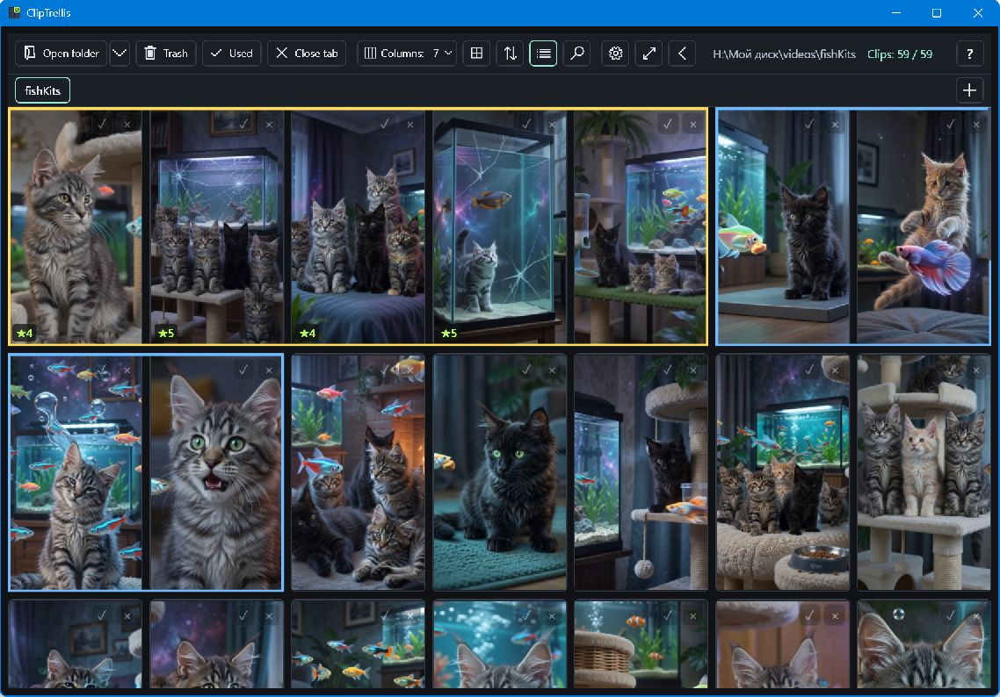
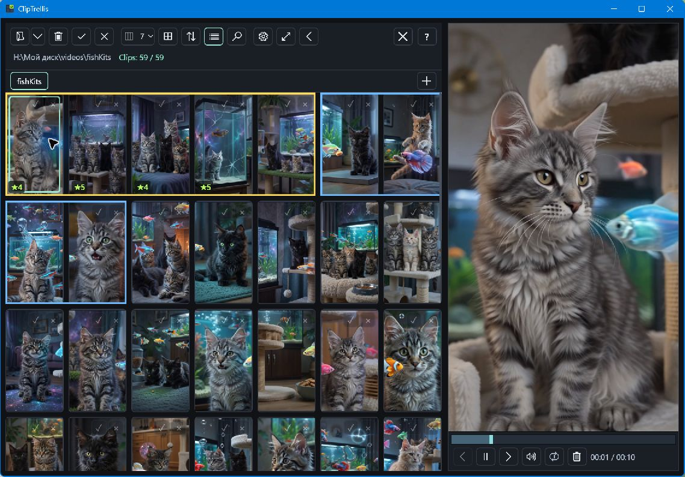

<h1 align="center"> ClipTrellis</h1>

  Browse, preview, and shortlist video clips for your next edit. 
  Просматривайте видео из папки, ставьте оценки и отбирайте клипы для монтажа.

  <strong><a href="https://github.com/korzhy/VideoWall-Releases/releases/latest/download/VideoWall-Setup-x64-with-dotnet.exe">Download for Windows / Скачать для Windows</a></strong> 
  64-bit / 64 бита · .NET included / .NET включён

  <a href="#get-started">English</a> · <a href="README.ru.md">Русский</a> · <a href="https://github.com/korzhy/VideoWall-Releases/releases/latest">What's new / Что нового</a>

## Get started

1. **Install.** Download the recommended installer above and run the `.exe`. It includes everything ClipTrellis needs to start.
2. **Open a folder.** Click **Open folder** or press <kbd>Ctrl</kbd>+<kbd>O</kbd> and choose a folder with videos. Double-click a thumbnail to see the clip alongside the grid.
3. **Make your shortlist.** Right-click a clip to add a color label or rating, or select clips and press <kbd>N</kbd> to number them. Drag a tile or the video in the preview into your editor when you're ready to use it.

See the grid and preview side by side

### A few useful controls

| What you want to do | How to do it |
| --- | --- |
| Keep several folders open | <kbd>Ctrl</kbd>+<kbd>T</kbd> opens a folder in a new tab. Each tab keeps its own selection, search, and preview position while you switch. |
| Find a clip | <kbd>Ctrl</kbd>+<kbd>F</kbd> searches by file name. |
| Review a sequence | <kbd>Space</kbd> plays or pauses the preview. <kbd>PgUp</kbd> and <kbd>PgDn</kbd> step through clips. |
| Put a clip aside | Click **✓** on a tile to file it under **Used**, or press <kbd>Delete</kbd> in the main grid to move it to ClipTrellis **Trash**. Both actions hide the clip from the grid and leave the file in its folder. Open either section to restore a clip. |

In **Trash** or **Used**, read the confirmation if you press <kbd>Delete</kbd>. In these views, it can delete the file from disk.

## Installation and updates

- **Windows 10 (version 21H2 or later) or Windows 11, x64.** Choose the download at the top for a first installation. The installer file begins with `VideoWall-Setup` and installs ClipTrellis.
- **Already have Microsoft .NET 10 Desktop Runtime x64?** Use the [smaller installer](https://github.com/korzhy/VideoWall-Releases/releases/latest/download/VideoWall-Setup-x64-without-dotnet.exe).
- **Updating?** Open **Settings → Check for updates**. For a manual update, use the same installer variant you originally installed. [All releases](https://github.com/korzhy/VideoWall-Releases/releases)
- **Changing the interface language?** Open **Settings → Interface language**, select **English** or **Русский**, and reopen ClipTrellis.

## Help

Press <kbd>F1</kbd> in ClipTrellis for the full shortcut list. If you can see a file in the grid but can't play it, try another MP4 first. Playback depends on the video format and the codecs available in Windows.

For a question or a bug, include your ClipTrellis version and what you were doing. If playback is involved, include the file extension. [Open an issue](https://github.com/korzhy/VideoWall-Releases/issues/new) · [Читать по-русски](README.ru.md)
