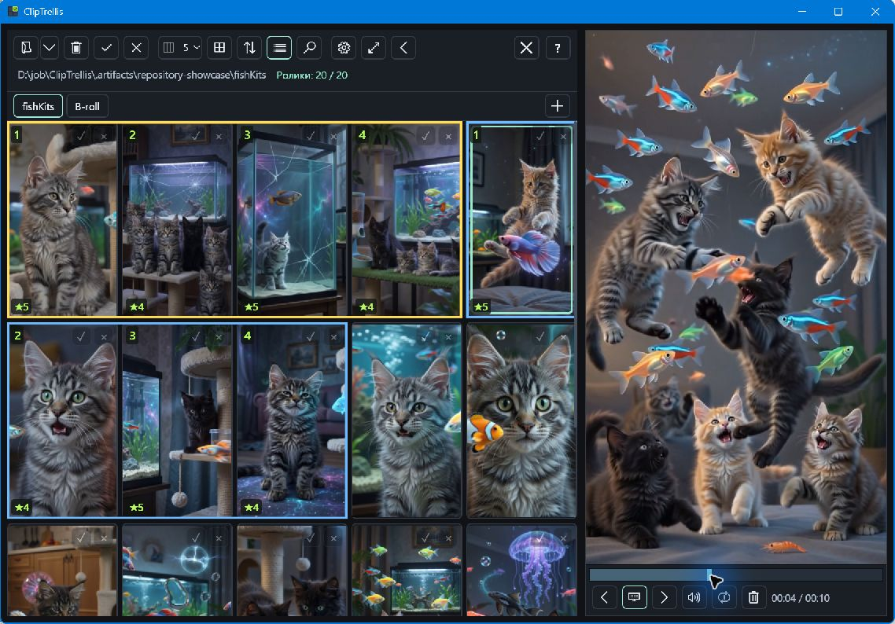

<h1> ClipTrellis</h1>

**Отбор видео перед монтажом в Windows.** Откройте папку с исходниками, просматривайте дубли рядом с сеткой и перетаскивайте выбранные ролики в видеоредактор.

**[Скачать для Windows](https://github.com/korzhy/VideoWall-Releases/releases/latest/download/VideoWall-Setup-x64-with-dotnet.exe)** · x64, .NET включён

[English](README.md) · [Руководство пользователя](docs/guide.ru.md) · [Что нового](https://github.com/korzhy/VideoWall-Releases/releases/latest)

*Подборка из fishKits. Цветные рамки разделяют группы, звёзды показывают рейтинг, а номера задают порядок просмотра. Справа ролик на паузе. Дополнительные кадры B-roll открыты в соседней вкладке.*

## От папки с исходниками до подборки для монтажа

1. **Просмотрите дубли.** Нажмите **Ctrl+O** и откройте папку. По умолчанию двойной щелчок по плитке открывает предпросмотр рядом с сеткой. **Пробел** запускает или приостанавливает видео, а **PgUp / PgDn** переключают ролики.
2. **Отметьте нужное.** В fishKits можно выделить сцены с аквариумом одним цветом, а крупные планы другим. **Alt+1–5** задаёт цвет, **Ctrl+1–5** — рейтинг, **N** нумерует выделенные ролики. Сортировка по рейтингу или номеру выносит отобранные клипы вперёд.
3. **Загляните в соседнюю папку за дополнительным кадром.** Откройте B-roll через **Ctrl+T**. По **Ctrl+Tab** можно вернуться к прежнему поиску, выделению и месту прокрутки. Предпросмотр восстановится на паузе на прежней позиции. Вкладки сохраняются до выхода из программы.
4. **Добавьте нужный ролик в монтаж.** Перетащите плитку или видео из предпросмотра в медиатеку редактора, например Clipchamp. После импорта нажмите **✓**, чтобы отметить ролик как использованный. В настройках можно включить автоматическую отметку, когда редактор принимает файл. Если ClipTrellis сам подставляет следующий ролик, тот открывается на паузе.

## Что происходит с файлами

| Действие | Результат |
| --- | --- |
| Перетащить ролик **из** ClipTrellis | Редактор получает путь к исходному файлу. Оригинал остаётся в своей папке. |
| Перетащить видео **в** ClipTrellis из Проводника | ClipTrellis копирует его в открытую папку. При совпадении имён добавляется числовой суффикс. Если добавить видео прямо в папку через Проводник, сетка и счётчик обновятся автоматически. |
| Отправить в **«Использованные»** или **«Корзину»** | Ролик скрывается из основной сетки. Его можно вернуть из соответствующего раздела. |
| Выбрать **«Переместить цветовую группу в новую папку»** | ClipTrellis переносит группу на диске и открывает новую подпапку. Метки, рейтинги и номера переносятся вместе с роликами. |

Удаление с диска выполняется отдельным действием с подтверждением внутри **«Корзины»** или **«Использованных»**. [Работа с файлами и восстановление](docs/guide.ru.md#работа-с-файлами)

## Установка и помощь

- **Windows 10 21H2 и новее или Windows 11, x64.** Установщик по ссылке вверху уже содержит среду выполнения. Файл `VideoWall-Setup` устанавливает ClipTrellis.
- **Уже установлен .NET 10 Desktop Runtime x64?** Подойдёт [компактный установщик](https://github.com/korzhy/VideoWall-Releases/releases/latest/download/VideoWall-Setup-x64-without-dotnet.exe). При обновлении вручную используйте тот же вариант установщика или откройте **Настройки → Проверить обновления**.
- **Чтобы сменить язык**, откройте **Настройки → Язык интерфейса**, выберите язык и перезапустите программу.
- В [руководстве](docs/guide.ru.md) есть сочетания клавиш, настройки предпросмотра, форматы и помощь с воспроизведением. Если что-то не работает, [сообщите об ошибке](https://github.com/korzhy/VideoWall-Releases/issues/new) и укажите версию программы и шаги.
