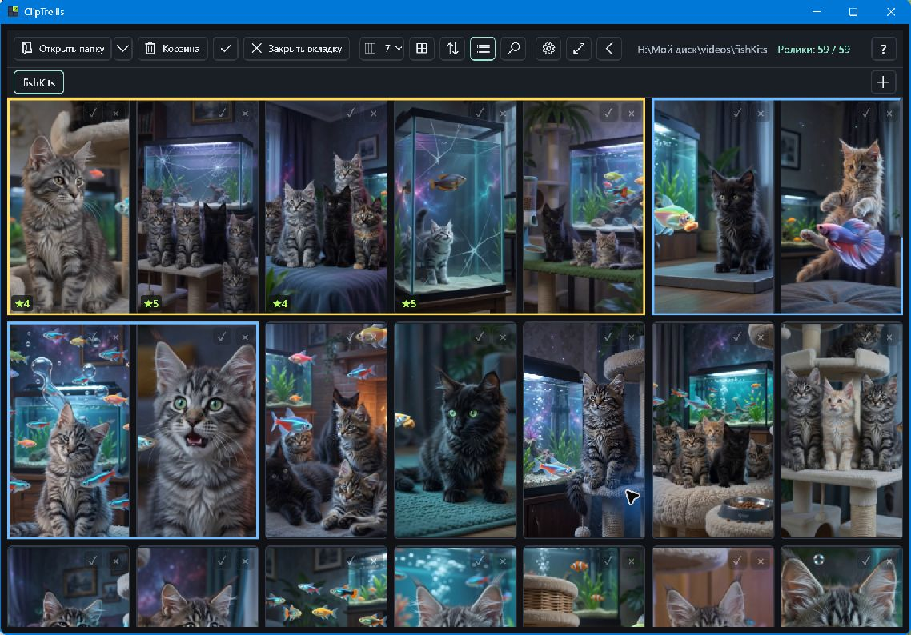
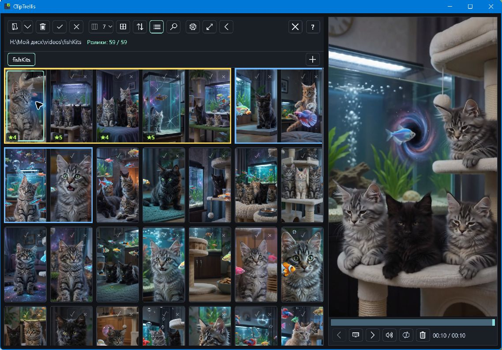

<h1 align="center">ClipTrellis</h1>

Просматривайте видео из папки, ставьте оценки и отбирайте клипы для монтажа.

  <strong><a href="https://github.com/korzhy/VideoWall-Releases/releases/latest/download/VideoWall-Setup-x64-with-dotnet.exe">Скачать для Windows</a></strong> 
  64 бита · .NET включён

  <a href="#первые-шаги">Русский</a> · <a href="README.md">English</a> · <a href="https://github.com/korzhy/VideoWall-Releases/releases/latest">Что нового</a>

## Первые шаги

1. **Установите программу.** Скачайте установщик по ссылке выше и запустите файл `.exe`. В него уже входит всё, что нужно для запуска ClipTrellis.
2. **Откройте папку.** Нажмите **Открыть папку** или <kbd>Ctrl</kbd>+<kbd>O</kbd> и выберите папку с видео. Дважды щёлкните по миниатюре, чтобы открыть предпросмотр рядом с сеткой.
3. **Отберите клипы.** Через меню правой кнопки мыши можно поставить оценку или добавить цветовую метку. Чтобы пронумеровать несколько клипов, выделите их и нажмите <kbd>N</kbd>. Перетащите плитку или видео из окна предпросмотра в редактор, когда будете готовы использовать ролик.

Посмотреть, как выглядят сетка и предпросмотр рядом

### Что пригодится при отборе

| Что нужно сделать | Как это сделать |
| --- | --- |
| Работать сразу с несколькими папками | <kbd>Ctrl</kbd>+<kbd>T</kbd> открывает папку в новой вкладке. При переключении вкладок сохраняются выделение, поиск и позиция предпросмотра. |
| Найти ролик | <kbd>Ctrl</kbd>+<kbd>F</kbd> ищет по имени файла. |
| Просмотреть несколько роликов подряд | <kbd>Пробел</kbd> ставит видео на паузу и возобновляет воспроизведение. <kbd>PgUp</kbd> и <kbd>PgDn</kbd> переключают ролики. |
| Убрать ролик из сетки | Кнопка **✓** на плитке отправляет ролик в **Использованные**. В основной сетке <kbd>Delete</kbd> отправляет его в **Корзину** ClipTrellis. В обоих случаях файл остаётся в своей папке, а ролик можно вернуть в сетку из соответствующего раздела. |

В **Корзине** и **Использованных** прочитайте сообщение при нажатии <kbd>Delete</kbd>. В этих разделах подтверждение может удалить файл с диска.

## Установка и обновления

- **Windows 10 (версия 21H2 или новее) или Windows 11, x64.** Для первой установки используйте ссылку вверху. Файл `VideoWall-Setup…exe` установит ClipTrellis.
- **Уже установлен Microsoft .NET 10 Desktop Runtime x64?** Можно скачать [компактный установщик](https://github.com/korzhy/VideoWall-Releases/releases/latest/download/VideoWall-Setup-x64-without-dotnet.exe).
- **Как обновить программу?** Откройте **Настройки → Проверить обновления**. При обновлении вручную используйте тот же вариант установщика, что и при первой установке. [Все версии](https://github.com/korzhy/VideoWall-Releases/releases)
- **Как поменять язык?** Откройте **Настройки → Язык интерфейса**, выберите **Русский** или **English** и перезапустите ClipTrellis.

## Помощь

Полный список сочетаний клавиш открывается по <kbd>F1</kbd>. Если ролик виден в сетке, но не воспроизводится, попробуйте открыть другой MP4. Воспроизведение зависит от формата видео и доступных в Windows кодеков.

Задать вопрос или сообщить об ошибке можно по ссылке ниже. Укажите версию ClipTrellis и опишите, что вы делали. Если дело в воспроизведении, укажите расширение файла. [Задать вопрос или сообщить об ошибке](https://github.com/korzhy/VideoWall-Releases/issues/new) · [Read in English](README.md)
