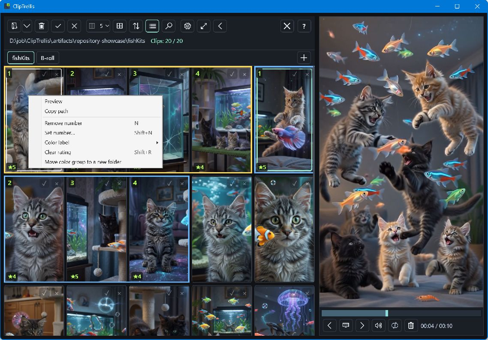

# ClipTrellis user guide

[Project and download](../README.md) · [Русская версия](guide.ru.md)

- [Review and select clips](#review-and-select-clips)
- [Work across folders](#work-across-folders)
- [File handling](#file-handling)
- [Formats and playback](#formats-and-playback)

## Review and select clips

Open the folder you want to review with **Ctrl+O**. The grid shows videos in that folder. Open a subfolder separately to review its contents.

| To do this | Use |
| --- | --- |
| Open a clip next to the grid | Double-click a tile by default, or select it and press **Enter**. |
| Play, pause or step through clips | **Space** plays or pauses. **PgUp / PgDn** opens the previous or next clip. **Ctrl+M** toggles sound. |
| Select several clips | **Ctrl+click** adds or removes a tile. **Shift+click** selects a range. With focus on the grid, **Ctrl+A** selects all visible results. |
| Give candidates a rating | **Ctrl+1–5** sets a rating. **Shift+R** or **Clear rating** in the tile menu removes it. Both work on a selection. |
| Label clips by scene | **Alt+1–5** assigns a color. **Alt+0** clears the label. **Ctrl+G** toggles grouping by color. |
| Number candidates | Select the clips and press **N**. It numbers the unnumbered clips in the selection. If they're all numbered, **N** clears the numbers. Select a single clip and press **Shift+N** to enter a specific number. |
| Change what comes first | Open **Sort** with **Alt+S** and choose an order, such as highest rated first. Drag tiles within the grid to set a manual order. Manual order pauses automatic grouping. |

Use **Ctrl+F** to find a clip by file name. For several clips, paste one name or path per line. **F1** opens the full shortcut list in ClipTrellis.

## Work across folders

Use **Ctrl+T** or the **+** button to open a second folder in its own tab. **Ctrl+Tab** switches forward and **Ctrl+Shift+Tab** switches back. Each tab keeps its search, selection, scroll position and preview position while ClipTrellis is open. A restored preview stays paused. **Ctrl+W** closes the active tab.

The active folder refreshes when files change. When you return to a background tab, ClipTrellis checks the folder again. **F5** refreshes the folder manually.

## File handling

**Hand a source clip to an editor.** Drag the tile or the video itself from the preview into an app that accepts files. The source stays where it is. If you enable **Move clips to Used after dragging** in Settings, ClipTrellis marks a clip as used after the destination accepts it for copying. In the editor, check that the clip is in its media list before continuing.

**Set clips aside or restore them.** Click **✓** or press **Ctrl+Delete** in the grid to mark a clip **Used**. **Delete** in the main grid sends it to ClipTrellis **Trash**. Both actions hide clips while keeping the files in place. Open **Used** or **Trash**, select the clips and press **Ctrl+Enter** to restore them. Inside these sections, **Delete** asks whether to delete the file from disk.

**Import from Explorer.** Drop supported videos onto the grid to copy them into the open folder. ClipTrellis keeps both files when names collide by giving the new copy a suffix like `(2)`.

**Turn a color group into a folder.** Right-click a labeled tile and choose **Move color group to a new folder**. This moves the matching group on disk, including group members hidden by search, and opens its new subfolder. The clips keep their color labels, ratings and numbers.

*In fishKits, a color group can become a subfolder directly from one of its tiles.*

## Formats and playback

ClipTrellis lists files with the extensions `MP4`, `M4V`, `MOV`, `MKV`, `WEBM`, `AVI`, `WMV`, `MPEG`, `MPG`, `TS`, `MTS`, `M2TS` and `3GP`. Preview playback depends on the codecs available in Windows. If one file fails, try a known-good MP4 in the same folder and open the problem file in a Windows player to narrow down the cause.

In **Settings**, you can choose single- or double-click to open a clip, start playing when opened manually, and configure or disable hover playback. To change the interface language, choose **Interface language** and restart ClipTrellis.

If you need help, [open a GitHub issue](https://github.com/korzhy/VideoWall-Releases/issues/new) with the ClipTrellis version, the steps you followed and what happened. For playback issues, include the file extension and codec if known.
