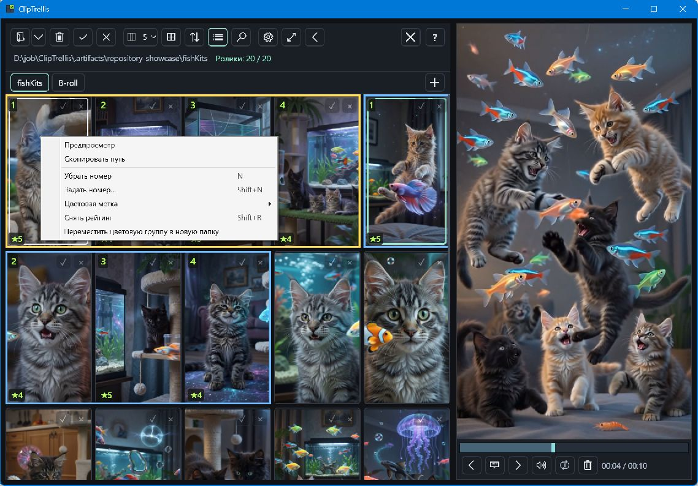

# Руководство по ClipTrellis

[О программе и загрузка](../README.ru.md) · [English version](guide.md)

- [Просмотр и отбор роликов](#просмотр-и-отбор-роликов)
- [Работа с несколькими папками](#работа-с-несколькими-папками)
- [Работа с файлами](#работа-с-файлами)
- [Форматы и воспроизведение](#форматы-и-воспроизведение)

## Просмотр и отбор роликов

Нажмите **Ctrl+O** и откройте нужную папку. Сетка показывает видео из этой папки. Чтобы просмотреть содержимое подпапки, откройте её отдельно.

| Что нужно сделать | Как это сделать |
| --- | --- |
| Открыть ролик рядом с сеткой | По умолчанию дважды щёлкните по плитке. Также можно выделить плитку и нажать **Enter**. |
| Запустить видео, поставить на паузу или перейти к соседнему | **Пробел** запускает и приостанавливает видео. **PgUp / PgDn** переключают ролики. **Ctrl+M** включает и выключает звук. |
| Выделить несколько роликов | **Ctrl+щелчок** добавляет или снимает выделение, **Shift+щелчок** выделяет диапазон. В сетке **Ctrl+A** выделяет все ролики текущего списка, в том числе результаты поиска. |
| Оценить удачные дубли | **Ctrl+1–5** ставит рейтинг. **Shift+R** или **«Снять рейтинг»** в меню плитки очищает его. Команды работают и с несколькими выделенными клипами. |
| Расставить метки по сценам | **Alt+1–5** назначает цвет, **Alt+0** снимает метку. **Ctrl+G** включает и выключает группировку по цвету. |
| Пронумеровать подборку | Выделите ролики и нажмите **N**. Номера появятся у роликов без номера. Если пронумерованы все выделенные, **N** снимает номера. Для точного номера одного ролика используйте **Shift+N**. |
| Вывести нужные клипы вперёд | Откройте сортировку через **Alt+S** и выберите порядок, например **«По рейтингу»**. Перетащите плитку внутри сетки для ручного порядка. В этом режиме автоматическая группировка приостанавливается. |

**Ctrl+F** ищет ролики по имени файла. Чтобы найти сразу несколько, вставьте имена или пути, по одному на строку. Полный список клавиш открывается по **F1**.

## Работа с несколькими папками

Откройте вторую папку через **Ctrl+T** или кнопку **+**. **Ctrl+Tab** переключает на следующую вкладку, **Ctrl+Shift+Tab** — на предыдущую. Пока ClipTrellis открыт, каждая вкладка помнит поиск, выделение, прокрутку и позицию предпросмотра. При возврате видео остаётся на паузе. **Ctrl+W** закрывает активную вкладку.

Сетка активной папки обновляется при изменениях файлов. Когда вы возвращаетесь к другой вкладке, ClipTrellis снова сверяет её с диском. **F5** обновляет папку вручную.

## Работа с файлами

**Передать клип в монтаж.** Перетащите плитку или видео из предпросмотра в приложение, которое принимает файлы. Исходник остаётся в своей папке. При включённой настройке **Убирать ролик в «Использованные» после перетаскивания** ClipTrellis отметит его использованным, когда получатель примет файл для копирования. Убедитесь, что ролик появился среди материалов редактора.

**Отложить или вернуть ролики.** Нажмите **✓** или **Ctrl+Delete** в сетке, чтобы отметить ролик как использованный. **Delete** в основной сетке отправляет ролик в корзину ClipTrellis. Оба действия скрывают плитки, а файлы остаются на месте. Откройте **«Использованные»** или **«Корзину»**, выделите ролики и нажмите **Ctrl+Enter**, чтобы вернуть их в сетку. Внутри этих разделов **Delete** запрашивает подтверждение удаления с диска.

**Импортировать видео из Проводника.** Перетащите поддерживаемые видео на сетку. ClipTrellis скопирует их в открытую папку. При совпадении имён программа сохранит оба файла, добавив новой копии суффикс вроде `(2)`.

**Вынести цветовую группу в отдельную папку.** Нажмите правой кнопкой по плитке с меткой и выберите **«Переместить цветовую группу в новую папку»**. ClipTrellis перенесёт группу на диске, включая клипы этого цвета, скрытые поиском, и откроет новую подпапку. Цветовые метки, рейтинги и номера сохранятся.

*В fishKits цветовую группу можно перенести из меню любой её плитки.*

## Форматы и воспроизведение

ClipTrellis показывает файлы с расширениями `MP4`, `M4V`, `MOV`, `MKV`, `WEBM`, `AVI`, `WMV`, `MPEG`, `MPG`, `TS`, `MTS`, `M2TS` и `3GP`. Воспроизведение зависит от кодеков Windows. Если один ролик не играет, попробуйте заведомо рабочий MP4 из той же папки и проверьте проблемный файл в проигрывателе Windows.

В **настройках** можно выбрать открытие по одному или двум щелчкам, включить запуск при ручном открытии ролика и настроить или выключить проигрывание при наведении. Чтобы сменить язык, откройте **«Язык интерфейса»** и перезапустите ClipTrellis.

Если нужна помощь, [создайте обращение на GitHub](https://github.com/korzhy/VideoWall-Releases/issues/new). Укажите версию ClipTrellis, последовательность действий и результат. Для ошибки воспроизведения добавьте расширение файла и кодек, если он известен.
